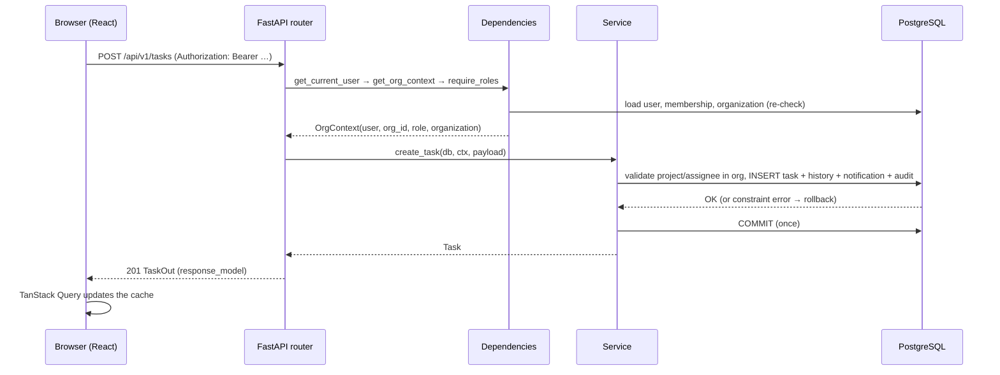
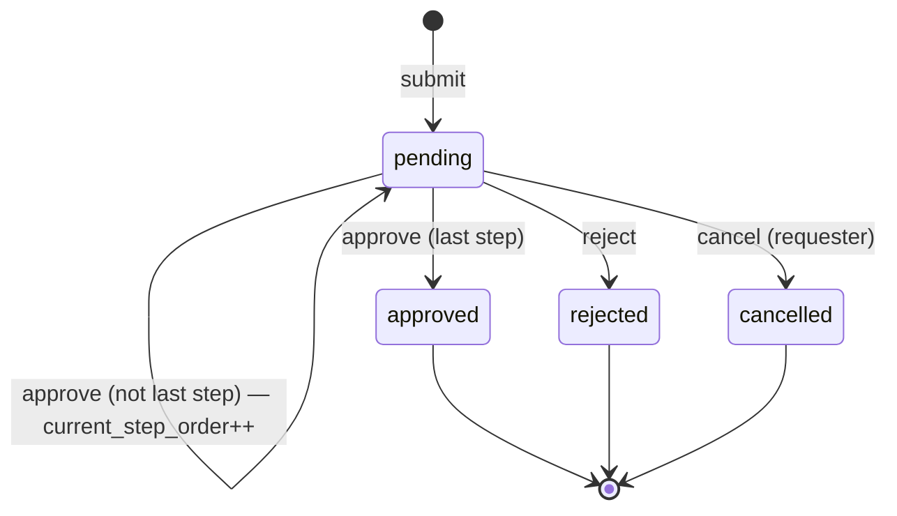

# Architecture Overview

## 1. Layered architecture

```
Browser (React SPA)
   │  fetch + Bearer token
   ▼
FastAPI router        (app/api/*)      — parse HTTP, call a service, return a schema
   ▼
Dependencies          (app/api/deps.py) — get_current_user → get_org_context → require_roles
   ▼
Service               (app/services/*)  — business logic + ONE transaction per request
   ▼
SQLAlchemy models     (app/models/*)    — ORM mapping
   ▼
PostgreSQL            — FKs, unique constraints, CHECKs, audit trigger (last safety net)
```

Routers never touch the database directly. Services receive the session, the acting user
and the verified `org_id` explicitly, and commit exactly once at the end. Any exception
rolls the whole request back.

## 2. Request flow (browser → database)



## 3. Tenancy model

- One database, one schema, **row-level tenancy**: every tenant-owned table has
  `org_id` (NOT NULL, FK to `organizations`, indexed).
- `users` and `organizations` are global tables.
- The `org_id` used by every query comes from the **verified context** (token claim
  re-checked against the `memberships` table), never from the request body.
- Tenant-safe helpers (`app/services/tenant.py`) are the only way to read a single row:
  `get_in_org()` returns 404 when the row belongs to another organization.
- Composite foreign keys `(org_id, parent_id) → (org_id, id)` make the database itself
  reject a row whose parent is in a different organization.

## 4. Auth and permission flow

1. `POST /auth/login` → access token (identity only).
2. `POST /auth/switch-organization` → new token carrying `org_id` (after verifying an
   active membership).
3. Every protected request: `get_current_user` decodes the JWT and loads the user
   (rejects inactive users with 401); `get_org_context` loads the **active membership and
   organization from the database** — a suspended org is blocked (403 `ORG_SUSPENDED`) and
   a missing membership is 403. It returns an `OrgContext`.
4. `require_roles(*roles)` enforces the permission matrix (`app/core/permissions.py`).

**Why re-check the DB instead of trusting the token:** a JWT is a snapshot. If a member is
removed or an org suspended, an old token would still look valid. Re-reading the
membership on every request makes revocation immediate.

## 5. Workflow state machine



- Only the current step's approver may decide; the requester never can.
- Final states (`approved`, `rejected`, `cancelled`) can never be decided again (409).
- The decision endpoint locks the row with `SELECT ... FOR UPDATE` and bumps `version`,
  so two approvers cannot both advance the same step.

## 6. Transaction strategy

- One transaction per request, committed once by the service.
- Multi-record changes (task + status history + notification + audit; request + decision +
  notification + audit) happen inside that single transaction — a failure leaves **no**
  partial rows.
- Notifications and audit rows are written by the same service call that changes the
  business data, so they can never diverge.

## 7. Key design decisions

| Decision | Alternative | Why |
| --- | --- | --- |
| Shared schema + `org_id` | schema-per-tenant, db-per-tenant | Cheapest and simplest; isolation is provable with tests. |
| 404 for cross-tenant IDs | 403 | 403 leaks that a resource exists. |
| DB trigger for append-only audit | app-level checks | Protects against application bugs too. |
| `FOR UPDATE` + `version` on decide | version only | Prevents concurrent double decisions. |
| Portable types (SQLite dev, PG prod) | PG-only | Zero-setup local dev while keeping the real PG path. |

## 8. Stronger isolation options for the future

1. **PostgreSQL Row Level Security (RLS).** Add `USING (org_id = current_setting('app.current_org')::uuid)`
   policies and `SET app.current_org` per transaction. Defence-in-depth behind the service
   layer. *Trade-off:* more setup; every connection must set the session variable.
2. **Schema-per-tenant.** One schema per organization. Strong separation, but migrations
   must run per schema and cross-tenant reporting gets harder.
3. **Database-per-tenant.** Strongest isolation, used for enterprise customers. Highest
   operational cost (connection pools, backups, migrations per tenant).

The current design keeps the door open: because all tenant access already goes through
`org_id`-scoped helpers, adding RLS is incremental rather than a rewrite.
