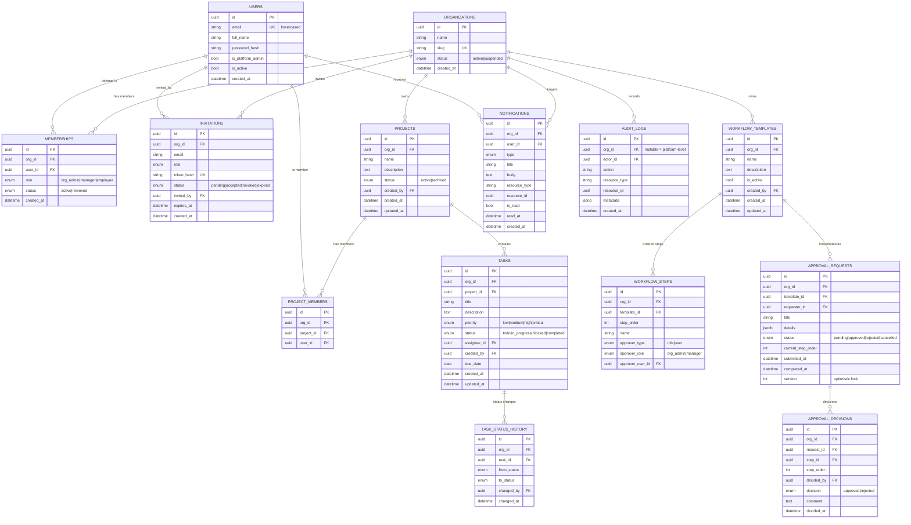

# ER Diagram

Shared database, shared schema, **row-level tenancy**: every tenant-owned table
carries `org_id`. Global tables are `users` and `organizations`.

## Key integrity rules

- **Composite foreign keys** `(org_id, parent_id) → (org_id, id)` on `tasks`,
  `project_members`, `task_status_history`, `workflow_steps`, `approval_requests`,
  `approval_decisions`: the database itself refuses a row whose parent lives in a
  different organization.
- `tasks(org_id, assignee_id) → memberships(org_id, user_id)`: an assignee must have
  a membership in the same organization.
- `UNIQUE(org_id, user_id)` on memberships; `UNIQUE(project_id, user_id)` on project
  members; `UNIQUE(template_id, step_order)`; `UNIQUE(request_id, step_order)`.
- Partial unique index on `invitations(org_id, email) WHERE status='pending'`.
- `audit_logs` is append-only via a database trigger.
